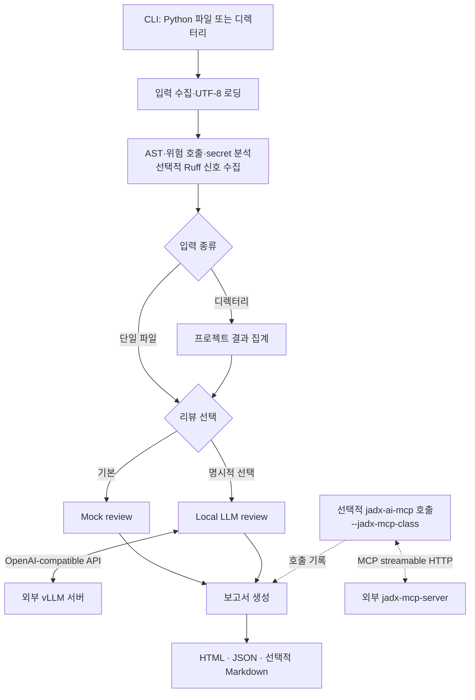

<div align="center">

# Project NuriLab

**Python 소스를 실행하지 않고 정적 보안 신호를 모아, HTML·JSON 보고서로 정리하는 로컬 우선 분석 도구**

[](pyproject.toml)
[](uv.lock)
[](docs/LOCAL_LLM_INTEGRATION_TEST.md)
[](docs/USAGE.md)
[](https://github.com/Malicious-code-detection-project/project_Nurilab/commits/main)

[빠른 시작](#빠른-시작) · [튜토리얼](#튜토리얼) · [구조](#현재-구조) · [결과](#검증-결과) · [사용 안내](docs/USAGE.md) · [아키텍처](docs/ARCHITECTURE.md)

</div>

Project NuriLab은 단일 `.py` 파일이나 Python 프로젝트 디렉터리를 받아 AST 구조, 위험 호출 후보,
hard-coded secret 후보와 선택적 Ruff 결과를 수집하고, 사람이 검토할 수 있는 HTML·JSON 보고서를 만듭니다.
장기 방향은 폐쇄적 환경에서도 쓸 수 있는 의심 파일·소스 분석 보조 시스템입니다. 현재 제품 계약은
**Python 정적 분석과 선택적 Local LLM review**이며, 코드의 악성 여부를 확정하거나 입력을 실행하지 않습니다.

## 하이라이트

- **판단 근거는 deterministic analyzer입니다.** LLM은 결과를 요약하고 우선순위와 권고안을 쓰지만, 정적 분석 결과를 덮어쓰지 않습니다.
- **기본은 오프라인입니다.** 기본 review는 Mock이고, 인터넷·GPU·모델 없이 분석부터 보고서까지 끝납니다.
- **Local LLM은 opt-in입니다.** `--review-client local`을 줄 때만 이미 실행 중인 vLLM OpenAI-compatible 서버를 호출하며, 원본 소스가 아니라 정규화된 정적 분석 payload만 보냅니다.
- **실패도 결과로 남깁니다.** 파일 로드·문법·Ruff·Local LLM 문제 중 계속할 수 있는 것은 finding이나 skipped 결과로 보고서에 남습니다.
- **실험 기능: jadx-ai-mcp.** 이미 실행 중인 [jadx-ai-mcp](https://github.com/zinja-coder/jadx-ai-mcp) 서버의 읽기 전용 tool을 호출해 그 기록을 보고서에 남길 수 있습니다. 이 결과는 판정에 쓰지 않습니다.

## 빠른 시작

요구 환경은 Python 3.12와 [uv](https://docs.astral.sh/uv/)입니다. GPU는 필요하지 않습니다.

```bash
git clone https://github.com/Malicious-code-detection-project/project_Nurilab.git
cd project_Nurilab
uv sync --locked
uv run python main.py analyze tests/fixtures/vulnerable_sample.py
```

결과는 `reports/`에 생성됩니다.

```text
reports/
├── vulnerable_sample.analysis.html
└── vulnerable_sample.analysis.json
```

프로젝트 디렉터리도 같은 명령으로 분석합니다.

```bash
uv run python main.py analyze tests
```

CLI 전체 option, 출력 형식, 환경변수와 Local LLM 설정은 [사용 안내](docs/USAGE.md)를 참조하세요.

## 튜토리얼

아래 출력은 2026-11-18 WSL2(Ubuntu, Python 3.12, uv 0.11.13)의 새 clone(main `fbc8fb8`)에서 실제로 실행한 결과입니다.
절대경로는 `<clone>`으로 줄였습니다.

### 1. 의도적으로 넣은 신호 찾기

`tests/fixtures/vulnerable_sample.py`는 위험 호출과 가짜 secret을 일부러 넣은 10줄짜리 무해한 fixture입니다.
Mock review와 `--no-ruff`로 분석하면 결과가 항상 같습니다.

```bash
uv run python main.py analyze tests/fixtures/vulnerable_sample.py --review-client mock --no-ruff
```

```text
Analyzed: <clone>/tests/fixtures/vulnerable_sample.py
Risk Level: high
HTML Report: <clone>/reports/vulnerable_sample.analysis.html
JSON Report: <clone>/reports/vulnerable_sample.analysis.json
```

보고서 JSON(`reports/vulnerable_sample.analysis.json`)에서 다음 신호를 확인할 수 있습니다.
Mock review는 이 신호로 finding 3개를 만들고 `Detected 3 review finding(s) in 10 line(s). Overall risk is high.`로 요약합니다.

```text
review.risk_level: high
analysis.suspicious_calls:
  - os.system, line 9, high
  - subprocess.run, line 10, medium
analysis.secrets:
  - api_key, line 5, preview: sk_t**************, high
```

이 값은 테스트용 신호이며 실제 비밀값이나 실제 악성 샘플이 아닙니다. JSON 보고서에는 각 신호와
review finding의 이유·권고안이 함께 저장됩니다. 같은 내용을 사람이 읽기 좋게 정리한 것이 HTML 보고서입니다.

### 2. 출력 형식 고르기

```bash
uv run python main.py analyze tests/fixtures/vulnerable_sample.py --format html json md --out /tmp/nurilab-demo
```

```text
Analyzed: <clone>/tests/fixtures/vulnerable_sample.py
Risk Level: high
HTML Report: /tmp/nurilab-demo/vulnerable_sample.analysis.html
JSON Report: /tmp/nurilab-demo/vulnerable_sample.analysis.json
MD Report: /tmp/nurilab-demo/vulnerable_sample.analysis.md
```

JSON은 기계가 읽는 canonical artifact, HTML은 기본 사람용 보기, Markdown은 선택 출력입니다.
세 형식은 같은 분석 결과에서 만들어집니다.

### 3. 테스트로 확인하기

```bash
uv run pytest
```

```text
502 passed, 13 skipped in 8.10s
```

기본 테스트에는 GPU와 Local LLM 서버가 필요하지 않습니다. 실제 Local LLM·jadx-mcp 서버를 쓰는 테스트와
외부 프로젝트 회귀 테스트는 환경변수(`NURILAB_RUN_LOCAL_LLM=1`, `NURILAB_RUN_JADX_MCP=1`,
`NURILAB_EXTERNAL_REGRESSION_ROOT`)를 줄 때만 실행되고, 없으면 skip됩니다.

### 4. (선택) Local LLM review

vLLM OpenAI-compatible 서버가 이미 떠 있다면 다음처럼 연결합니다. NuriLab은 서버를 시작·종료하거나
모델을 내려받지 않습니다. 설정 방법은 [사용 안내](docs/USAGE.md)와
[Local LLM 통합 테스트](docs/LOCAL_LLM_INTEGRATION_TEST.md)를 참조하세요.

```bash
uv run python main.py analyze tests --review-client local
```

서버에 연결할 수 없으면 Mock 성공으로 바꾸지 않습니다. 서버 없이 위 명령을 실행하면 정적 분석과 보고서는
그대로 만들어지고, review는 다음처럼 실패를 기록합니다.

```text
Risk Level: unknown
review.summary: Local LLM review failed. Static analysis results are still available.
review.findings: Local LLM connection failed (medium)
```

## 현재 구조



단일 파일은 분석 결과를 곧바로 review로 전달합니다. 디렉터리 입력은 파일별 분석을
`ResultAggregator`가 프로젝트 요약으로 집계한 뒤 review합니다. `--jadx-mcp-class`를
준 경우에만 review 뒤에 외부 MCP tool을 한 번 호출하고, 그 상태와 출처를 보고서의
별도 영역에 기록합니다. 모듈별 책임과 데이터 계약, 실패 경계는
[아키텍처 문서](docs/ARCHITECTURE.md)에 설명합니다.

| 영역 | 책임 |
| --- | --- |
| 입력·정적 분석 | Python 소스 수집과 재현 가능한 위험 신호 생성 |
| 집계 | 파일별 결과를 프로젝트 요약으로 결합 |
| 리뷰 | Mock 또는 외부 Local LLM으로 신호를 해석 |
| 외부 MCP (실험적) | 허용한 읽기 전용 tool 호출과 상태·출처 기록 |
| 보고서 | 같은 결과를 HTML/JSON/선택적 Markdown으로 표현 |

### Local LLM의 역할과 분리

Local LLM 경로는 vLLM OpenAI-compatible API를 호출합니다. 분석 애플리케이션은
서버를 시작·종료하거나 모델을 내려받거나 GPU를 관리하지 않습니다. 모델 서버와
분석 프로세스를 분리하면 모델 로딩 및 GPU 문제와 분석·보고서 문제를 독립적으로
운영할 수 있고, 하나의 서버를 여러 분석에서 재사용할 수 있습니다.

Local LLM에는 원본 source text가 아니라 정규화된 정적 분석 payload만 전달합니다.
응답은 strict JSON schema의 `summary`, `risk_level`, `findings`를 따라야 하며,
`risk_level`과 finding `severity`는 `low`, `medium`, `high`만 허용합니다.
응답의 별도 reasoning 필드는 사용하지 않습니다. 다만 JSON/schema 실패의 진단에는
응답 content 일부가 포함될 수 있습니다. 연결·timeout·HTTP·JSON/schema
실패는 분석 pipeline 전체를 멈추지 않고 `local_llm` finding으로 남습니다.

## 검증 결과

### 외부 프로젝트 회귀 (2026-09-17 재검증)

고정한 commit의 외부 프로젝트 세 개를 Mock review로 분석해 기준선과 비교했습니다.
외부 프로젝트의 패키지를 설치하거나 소스를 실행하지 않습니다.
조건과 고정 commit은 [외부 프로젝트 검증](docs/external_project_validation.md)에 있습니다.

| 대상 | 분석 Python 파일 | skipped | Mock findings | Ruff findings | 기준선 |
| --- | ---: | ---: | ---: | ---: | --- |
| [pypa/packaging](https://github.com/pypa/packaging) | 74 | 0 | 64 | 0 | 일치 |
| [pallets/click](https://github.com/pallets/click) | 79 | 0 | 27 | 0 | 일치 |
| [psf/requests](https://github.com/psf/requests) | 37 | 0 | 137 | 0 | 일치 |

### Local LLM 예비 진단 (2026-07-27)

RTX A6000 48 GB에서 `openai/gpt-oss-20b`를 vLLM으로 띄우고 `tests/` 디렉터리를 분석했습니다.
호환성 원인을 찾기 위한 예비 기록이며, 선택형 pytest의 최종 성공 기록을 대신하지 않습니다.
자세한 내용은 [Local LLM 통합 테스트](docs/LOCAL_LLM_INTEGRATION_TEST.md)에 있습니다.

| 항목 | 결과 |
| --- | --- |
| 분석 파일 | 21개 중 21개 완료, skipped 0개 |
| 최종 risk | `high` |
| Local LLM findings | 14개 (`high` 11, `medium` 1, `low` 2) |
| Local LLM failure finding | 0개 |

## 현재 한계

- Python 소스만 분석하며, 입력 코드를 실행하지 않습니다.
- 위험 호출은 직접 import alias를 정규화하고 일부 호출 인자·실행 문맥을 확인합니다.
  전체 data flow나 악성 의도를 추론하는 분석은 아닙니다.
- secret 탐지는 후보 신호이며, 실제 secret 또는 악성 여부의 판정이 아닙니다.
- 기본값은 Mock입니다. Local LLM을 선택한 상태에서 서버가 없으면 실패 finding을
  남기며 Mock 성공으로 바꾸지 않습니다.
- jadx-ai-mcp 연동은 실험적 opt-in이며 `get_class_source` 한 번만 호출합니다.
  대상 APK는 NuriLab 정적 분석 범위가 아니고, JADX-GUI에 열린 APK와
  `--jadx-mcp-target`이 일치하는지 검증하지 않습니다. 받은 결과는 비신뢰 보조
  기록이며 finding, risk level, review 입력에 쓰지 않습니다.
- remediation 코드 생성, 동적 분석, 실제 악성 샘플 실행, 이 저장소에서의
  파인튜닝은 현재 범위가 아닙니다.

## 로드맵과 MCP 연동

현재 작업 순서와 완료 조건은 [개발 로드맵](docs/PLAN.md), 실제 상태는 Linear
`The Debugging Water Deer` 팀의 `Nurilab` 프로젝트가 정본입니다.

사용자가 선정한 [jadx-ai-mcp](https://github.com/zinja-coder/jadx-ai-mcp)를 NuriLab에서
호출하는 MCP 클라이언트 연결(`THE-150`)은 `THE-151` 연결 계약, `THE-154` 연결,
`THE-155` 보고서 기록과 실패·반복 호출 검증까지 실험적 opt-in 기능으로
구현했습니다. 사용법은 [사용 가이드](docs/USAGE.md), 계약과 실측 기록은
[THE-151 연결 계약](docs/THE-151_jadx_mcp_contract.md)을 참조하세요.

다음 개발은 웹 분석 MVP(`THE-157`)입니다. 웹 walking skeleton(`THE-160`)이 들어갔고,
결과 출처 표시와 LLM 실패 처리(`THE-161`), 웹·CLI 일치 검증과 실행 문서(`THE-162`)가 남아
있습니다. 아직 제공 중인 기능은 아니며, 범위와 설계는 [개발 로드맵](docs/PLAN.md)과
[웹 MVP 설계](docs/WEB_MVP_DESIGN.md)를 따릅니다.

RAG와 Sandbox 구축·연동은 제외합니다. 파인튜닝 방향과 실행은
별도 프로젝트에서 재검토하며, NuriLab에는 준비된 외부 모델의 API 연결만 후속
`THE-80`으로 남깁니다. 모델 준비는 MCP 연동의 선행 조건이 아닙니다.

## 폴더 구조

```text
project_Nurilab/
├── main.py                 # CLI 진입점 (project_nurilab.cli 호출)
├── project_nurilab/
│   ├── input/              # 입력 수집과 UTF-8 로딩
│   ├── analyzers/          # AST, 위험 호출, secret, Ruff 신호
│   ├── aggregation/        # 프로젝트 summary와 risk 집계
│   ├── llm/                # Mock / Local review client
│   ├── external/           # 외부 MCP tool 계약 판정과 client (실험적)
│   ├── reports/            # HTML, JSON, Markdown 렌더링
│   ├── web/                # 웹 MVP (개발 중, THE-157)
│   ├── schemas.py          # 단계 사이 데이터 계약
│   ├── pipeline.py         # 분석 흐름 조정
│   ├── cli.py              # CLI option과 backend 선택
│   └── config.py           # 기본값과 제외 경로
├── tests/                  # 회귀 테스트와 fixture
├── docs/                   # 사용·설계·검증 문서
├── references/             # 출처와 상태를 표시한 참고 자료
└── .ai_rules/              # 모듈별 AI 코딩 규칙
```

## 개발

PR 전에는 다음 검사를 통과해야 합니다. 기본 테스트에는 Local LLM 서버가 필요하지
않습니다. 실제 서버 검증은 별도 선택형 테스트입니다.

```bash
uv run pytest
uv run ruff check .
uv run ruff format --check .
uv run mypy .
```

작업은 Linear 이슈로 추적하고 GitHub PR에서 검토합니다. Owner의 병합 확인 뒤
완료 처리합니다. [협업 규칙](AGENTS.md), [기여 절차](docs/CONTRIBUTING.md),
[전체 문서 지도](docs/README.md), [공유 참고 자료](references/README.md)를 참조하세요.

실제 악성 샘플, secrets, 승인받지 않은 소스, 생성 보고서와 모델 산출물은 커밋하지
않습니다. 개인 하네스 설치는 실행이나 기여의 필수 조건이 아닙니다.

## 기여자와 참고

- 기여자: [@jeongminllee](https://github.com/jeongminllee), [@kwonoseong0803](https://github.com/kwonoseong0803), [@seungsub56-ux](https://github.com/seungsub56-ux)
- 초기 설계는 길벗의
  [A2A × MCP 멀티에이전트 오케스트레이션 실전 / Code_Vulnerability](https://github.com/gilbutITbook/080493/tree/main/Code_Vulnerability)를
  참고했습니다. 현재는 단일 프로세스 Python pipeline이며, MCP는 선택적으로 외부 서버에 접속하는
  클라이언트로만 사용합니다.
- 관련 프로젝트: 보안 분석 특화 로컬 LLM은 별도 저장소
  [AegisLM](https://github.com/Malicious-code-detection-project/AegisLM)에서 개발합니다.

초기 설계도와 발표 Q&A, 당시의 가정 및 현재 결정과의 차이는
[역사 기록](docs/HISTORY.md)에 보존합니다. 과거 문서는 현재 제품 계약을 대체하지
않습니다.
